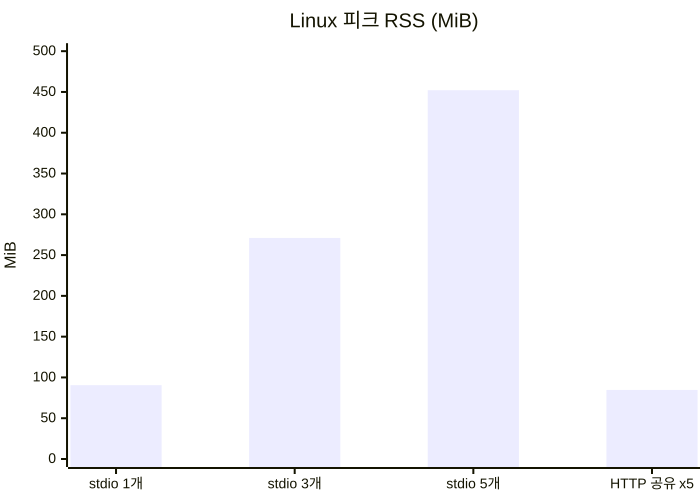

<div align="center">


# notion-mcp-shared
[English](README.md)

로컬 HTTP 서비스 하나가 여러 AI 클라이언트의 Notion MCP 요청을 처리합니다.

Node.js · Python 3

[](https://github.com/elfenomenokim/notion-mcp-shared/blob/main/LICENSE)

stdio 클라이언트 5개가 452.17MiB를 쓰고, 같은 5개 세션이 공유 프로세스 하나에서 84.64MiB로 끝납니다. 저장된 Linux 측정에서 가져왔습니다.

[설치](#설치) · [구조](#구조) · [공식 서버와의 차이](#공식-서버와의-차이) · [클라이언트 설정](#클라이언트-설정)

</div>

<p align="center">
<picture>
  <source media="(prefers-color-scheme: dark)" srcset="https://raw.githubusercontent.com/elfenomenokim/notion-mcp-shared/main/docs/diagrams/notion-mcp-shared.ko.dark.svg">
  <source media="(prefers-color-scheme: light)" srcset="https://raw.githubusercontent.com/elfenomenokim/notion-mcp-shared/main/docs/diagrams/notion-mcp-shared.ko.svg">
  
</picture>
</p>

## 설치

Node.js, npm, Python 3, curl, tar와 Notion integration token이 필요합니다.

```sh
./install.sh --secret
./install.sh
```

첫 명령은 서비스 bearer token을 권한 600인 로컬 파일에 저장합니다. 값은 그대로 저장하므로 token에 `#`이 있어도 잘리지 않습니다. 각 클라이언트 프로세스에 `NOTION_TOKEN`을 설정하세요. 서비스는 요청마다 그 값을 전달합니다. 기본 주소는 `http://127.0.0.1:58983/mcp`입니다.

설치 스크립트는 기존 launcher나 service unit을 덮어쓰지 않습니다. 번들 빌드가 중간에 끊겼다면 `./install.sh`를 다시 실행하세요. 런타임 디렉터리를 다시 빌드하고, 빌드가 끝난 뒤에만 새 번들을 게시합니다.

macOS에서는 LaunchAgent, Linux에서는 `systemd --user`로 실행합니다. Linux 설치는 Ubuntu에서 실행해 봤습니다. 기존 macOS LaunchAgent는 따로 유지되며 공개 설치 스크립트를 macOS에서 직접 실행하지는 않았습니다.

## 구조

<picture>
  <source media="(prefers-color-scheme: dark)" srcset="https://raw.githubusercontent.com/elfenomenokim/notion-mcp-shared/main/docs/diagrams/notion-mcp-shared.ko.dark.svg">
  
</picture>

`Authorization: Bearer`는 로컬 서비스에 접속할 때 사용합니다. `Notion-Token` 헤더는 요청별 Notion 계정을 고릅니다. 서비스 프로세스는 계정 token을 보관하지 않습니다.

## 공식 서버와의 차이

Notion 도구는 [`makenotion/notion-mcp-server`](https://github.com/makenotion/notion-mcp-server)에서 옵니다. OpenAPI 스펙을 고치지 않으므로 도구 24개가 upstream 2.5.2, 2.6.1과 2026-11-19의 `main`에서 모두 같습니다. 이 프로젝트는 그 서버를 감싸는 프로세스, 서비스, 비밀값 처리를 더합니다. 두 번째 Notion 클라이언트가 아니라 공식 서버 위의 얇은 계층입니다.

| | 공식 서버 | 이 프로젝트 |
|---|---|---|
| Notion 도구 | OpenAPI 스펙에서 만든 24개 | 같은 24개, 수정 없음 |
| 전송 | stdio, Streamable HTTP | Streamable HTTP |
| 접속 인증 | `--auth-token` 또는 `AUTH_TOKEN` | `0600` 파일에서 읽은 bearer를 환경으로 전달 |
| 요청별 계정 | `--enable-token-passthrough`, `Notion-Token` 헤더 | 같음 |
| 프로세스 수명 | 사용자가 직접 실행 | launchd 또는 systemd 사용자 서비스 |
| upstream 수정 | 없음 | 고정한 번들에 패치 1개 |

이 프로젝트가 더하는 것:

- 세션마다 프로세스를 띄우는 대신 Node 절대 경로를 쓰는 사용자 서비스 하나.
- bearer를 파일에서 그대로 읽고 심볼릭 링크, 소유자, `0600` 권한, 하드 링크 개수를 확인한 뒤 환경으로 넘깁니다. 값은 `ps`에도 `--auth-token` 인자에도 남지 않습니다. 시작 전에 상속된 `NOTION_TOKEN`과 `AUTH_TOKEN`을 지우므로 의도하지 않은 계정으로 응답하지 않습니다.
- 런타임, 비밀값, Node 가운데 하나라도 없으면 exit 78로 시작을 거절합니다.
- upstream `main`에 아직 없는 수정 하나. 없어진 세션 ID에는 HTTP 404를 돌려주므로 Streamable HTTP 클라이언트가 세션을 새로 만듭니다. upstream은 400을 주고 클라이언트는 같은 요청을 다시 시도합니다. 이 프로젝트가 lockfile에서 고치던 스키마 보존은 2.6.0부터 upstream 자체 수정(#335)이라, 2.6.1 번들은 의존성 패치를 넣지 않습니다.
- 클라이언트 예제와 아래 측정값.

더하지 않는 것: OAuth, 의미 검색, 연결 앱 검색, Markdown 기반 페이지 편집, 호스팅 운영. Notion이 지원하는 경로는 [Remote Notion MCP](https://developers.notion.com/docs/mcp)이며, 이 프로젝트는 그 서비스를 대신하거나 직접 운영할 수 없습니다.

2026-11-19에 확인한 upstream 상태: 저장소 README는 이 self-hosted 서버를 더 이상 적극적으로 유지하거나 지원하지 않는다고 밝힙니다. 이슈와 풀 리퀘스트도 적극적으로 보지 않으며 저장소를 종료할 수 있다고 적습니다. npm 배포는 아직 나옵니다. 2.6.0은 2026-10-28, 2.6.1은 2026-10-29입니다.

클라이언트 하나가 integration 하나로 도구만 필요하면 공식 서버를 직접 실행하세요.

```sh
npx @notionhq/notion-mcp-server --transport http --auth-token "$(cat ~/.secrets/notion.env)"
```

세션 여러 개가 계정 묶음 하나를 함께 쓰고 클라이언트마다 자기 Notion token을 보내야 할 때 이 프로젝트를 씁니다.

upstream이 없어진 세션에 404를 주고 같은 비밀값 처리를 하는 사용자 서비스를 함께 배포하면 이 프로젝트는 필요 없어집니다. 스키마 보존은 2.6.0이 스펙 객체 identity 캐시에서 이미 고쳤습니다(upstream #335). 새 revision은 `scripts/start-server.ts`의 세션 응답 두 줄에서 확인하세요.

## 클라이언트 설정

`clients/`에서 Claude Code, Codex, Pi, Antigravity, Kimi Code에 맞는 예제를 복사하세요. 클라이언트 프로세스가 bearer token과 `NOTION_TOKEN`을 읽을 수 있어야 합니다.

## 측정값

Ubuntu Linux에서 Node.js v22.23.5로 측정했습니다. 각 stdio 프로세스가 MCP `initialize`와 `tools/list`를 끝냈습니다. 공유 서비스는 같은 요청을 HTTP 클라이언트 5개가 동시에 보냈을 때 처리했습니다. 각 응답은 도구 24개를 반환했습니다. RSS는 실행 중과 완료 후 1초 동안 샘플링한 피크입니다.

| stdio MCP 프로세스 | stdio 전체 RSS | HTTP 세션 5개의 공유 서비스 RSS |
|---:|---:|---:|
| 1개 | 90.50 MiB | 84.64 MiB |
| 3개 | 271.04 MiB | 84.64 MiB |
| 5개 | 452.17 MiB | 84.64 MiB |

공유 서비스는 매 행에서 Node 프로세스 하나를 사용했습니다. 측정 자료는 [`docs/bench/linux-2026-11-17.json`](docs/bench/linux-2026-11-17.json)에 있습니다.

<picture>
  <source media="(prefers-color-scheme: dark)" srcset="https://raw.githubusercontent.com/elfenomenokim/notion-mcp-shared/main/docs/diagrams/notion-mcp-shared-rss.ko.dark.svg">
  
</picture>

설치 후 측정할 때 실행한 명령입니다.

```sh
server_pid=$(systemctl --user show notion-mcp-shared.service -p MainPID --value)
python3 docs/bench/measure.py \
  --node "$(command -v node)" \
  --runtime "$HOME/.local/share/notion-mcp-shared/runtime/bin/cli.mjs" \
  --endpoint http://127.0.0.1:58983/mcp \
  --server-secret "$HOME/.secrets/notion-mcp-shared.env" \
  --server-pid "$server_pid" --counts 1 3 5 \
  --output docs/bench/linux-2026-11-17.json
```

측정 명령은 `benchmark-no-api-call` 가짜 token을 쓰고 환경의 `NOTION_TOKEN`은 무시합니다. 실제 계정 token이 서버로 가지 않습니다. 도구 목록만 받고 Notion API를 호출하지 않습니다. 별도로 테스트 서비스에서 읽기 전용 `API-post-search` 요청 한 건이 성공했습니다. 이후 테스트 서비스와 임시 파일을 모두 지웠습니다.

## Upstream 수정안

`upstream-prs/`에는 `makenotion/notion-mcp-server`에 보낼 패치, 재현 방법, 제안 브랜치 이름과 PR 본문을 보관합니다. 스키마 dereferencer 패치는 2.6.0부터 upstream에서 고쳐졌으므로(#335) 기록으로만 남기고 적용하지 않습니다. 없어진 세션 패치만 적용합니다. 아직 PR을 열지 않았습니다.

## 범위

서비스는 loopback 주소에 바인딩되며 로컬 사용자 한 명을 위한 구성입니다. 번들은 upstream 2.6.1(commit `cf16e5c2`)을 고정하고 문서에 적은 호환성 수정 하나를 적용합니다. 고정을 옮기려면 그 패치를 그 revision에 맞춰 다시 만들어야 합니다. 데모 자료와 자격 증명은 모두 가짜입니다.

## 기여

이슈와 풀 리퀘스트를 환영합니다. 번들 빌드와 리뷰 방식은 [CONTRIBUTING.md](CONTRIBUTING.md)에 있습니다.

## 라이선스

MIT입니다. Notion과 제휴하지 않은 비공식 커뮤니티 도구입니다.
