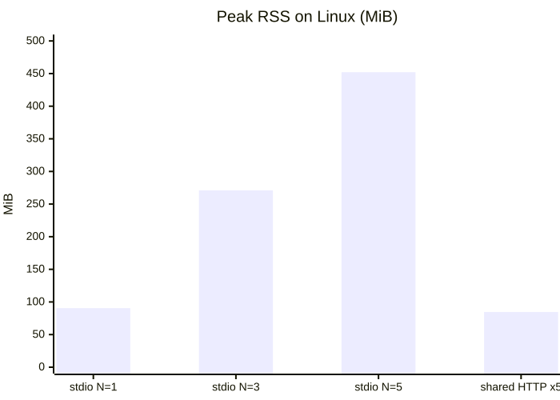

# notion-mcp-shared
[한국어](README.ko.md)

A local HTTP service lets multiple AI clients share one Notion MCP server process.

<picture>
  <source media="(prefers-color-scheme: dark)" srcset="https://raw.githubusercontent.com/elfenomenokim/notion-mcp-shared/main/docs/diagrams/notion-mcp-shared.dark.svg">
  <source media="(prefers-color-scheme: light)" srcset="https://raw.githubusercontent.com/elfenomenokim/notion-mcp-shared/main/docs/diagrams/notion-mcp-shared.svg">
  
</picture>

## Install

Requirements: Node.js, npm, Python 3, curl, tar, and a Notion integration token.

```sh
./install.sh --secret
./install.sh
```

The first command stores a local service bearer in a mode-600 file. Configure each client with its own `NOTION_TOKEN`; the service passes that token per request. The service listens on `http://127.0.0.1:58983/mcp` by default.

The installer supports macOS LaunchAgent and Linux `systemd --user` services. The Linux installer was exercised on an Ubuntu host. The existing macOS LaunchAgent remains on its prior installation; this public installer has not been exercised on macOS.

## Architecture

<picture>
  <source media="(prefers-color-scheme: dark)" srcset="https://raw.githubusercontent.com/elfenomenokim/notion-mcp-shared/main/docs/diagrams/notion-mcp-shared.dark.svg">
  
</picture>

The `Authorization: Bearer` value authenticates clients to the local service. The `Notion-Token` header selects the Notion account for each request. The service does not keep an account token.

## Client configuration

Copy the matching example from `clients/`: Claude Code, Codex, Pi, Antigravity, or Kimi Code. The bearer token and `NOTION_TOKEN` must be available in the client process environment.

## Measurements

On a Linux host with Node.js v22.23.5, each stdio process completed MCP `initialize` and `tools/list`. The shared server completed the same calls for five concurrent HTTP sessions. Each response listed 24 tools. RSS is the peak process total sampled during and for one second after each run.

| stdio MCP processes | Total stdio RSS | Shared server RSS with 5 HTTP sessions |
|---:|---:|---:|
| 1 | 90.50 MiB | 84.64 MiB |
| 3 | 271.04 MiB | 84.64 MiB |
| 5 | 452.17 MiB | 84.64 MiB |

The shared service used one Node process in every row. The measurements come from [`docs/bench/linux-2026-11-17.json`](docs/bench/linux-2026-11-17.json).

<picture>
  <source media="(prefers-color-scheme: dark)" srcset="https://raw.githubusercontent.com/elfenomenokim/notion-mcp-shared/main/docs/diagrams/notion-mcp-shared-rss.dark.svg">
  
</picture>

Reproduce the process and concurrency measurement after installation:

```sh
server_pid=$(systemctl --user show notion-mcp-shared.service -p MainPID --value)
NOTION_TOKEN=benchmark-no-api-call python3 docs/bench/measure.py \
  --node "$(command -v node)" \
  --runtime "$HOME/.local/share/notion-mcp-shared/runtime/bin/cli.mjs" \
  --endpoint http://127.0.0.1:58983/mcp \
  --server-secret "$HOME/.secrets/notion-mcp-shared.env" \
  --server-pid "$server_pid" --counts 1 3 5 \
  --output docs/bench/linux-2026-11-17.json
```

The benchmark sends a placeholder Notion token only to list tools; it makes no Notion API calls. One separate read-only `API-post-search` call through the test service succeeded. The test service and its temporary files were then removed.

## Upstream fixes

`upstream-prs/` contains two local patch files, reproduction steps, proposed branch names, and PR text for `makenotion/notion-mcp-server`. No PR is open.

## Limits

The service binds to loopback and is intended for one local user account. The bundle pins an upstream revision and applies the two documented compatibility fixes. Demo data and demo credentials are synthetic.

## License

MIT. This project is an unofficial community tool and is not affiliated with Notion.
